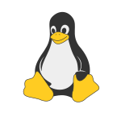
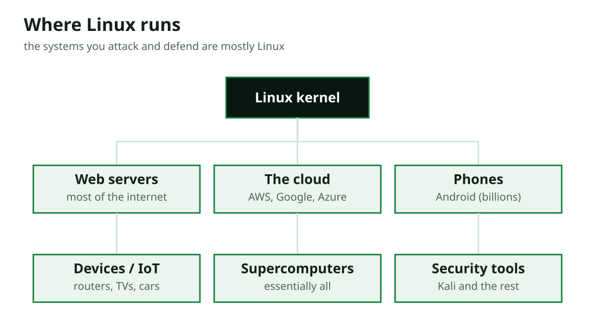

# Section 1: Why Security People Use Linux

> Covers chapter 1 in the [outline](../../../planning/outline.md).

## What You Will Learn

- What Linux is.
- What "open source" means, and why it matters for security.
- Where Linux runs: servers, the cloud, phones, and devices.
- Why almost every security tool lives on Linux.
- What a distribution is, and which ones you will use.
- The command-line mindset, and why security people prefer it.
- What this course covers.

## Before You Start

You need Security Fundamentals (01) and How Computers Work (02). From course 02 you know what an operating system is, a kernel, processes, files, and the command line's existence. This lesson explains *why* Linux, in particular, is the operating system security people live in. There are no commands yet; the hands-on work starts in lesson 2, when you install Linux in a virtual machine (building directly on course 02's virtualization lesson).

---

## 1. What Linux Is

**Linux is an operating system**, like Windows or macOS (course 02, lesson 5): the software that manages a computer's hardware and runs its programs. The name technically refers to the **kernel**, the privileged core you met in course 02, written originally by Linus Torvalds in 1991 and developed since by thousands of people worldwide. In everyday use, "Linux" means the whole operating system built around that kernel.

Two things make Linux different from Windows and macOS, and both matter enormously for security:

- **It is free and open source** (topic 2): anyone can get it, use it, study it, and change it, at no cost.
- **It is built around the command line** (topic 6): while Linux has graphical desktops, its heart and its power are in text commands typed into a shell.

You may rarely see Linux on a home laptop, where Windows and macOS dominate. But step behind the scenes of the internet, and Linux is everywhere: it runs most of the world's servers, most of the cloud, the Android phones in billions of pockets, and countless devices. For a security person, Linux is not an alternative to learn someday; it is the ground you will stand on every day.

## 2. Open Source, and Why It Matters for Security

**Open source** means the source code (course 02, lesson 8) is public: anyone can read it, check it, and modify it. Linux is the most famous open-source project in the world. This is the opposite of **closed source** (or proprietary) software like Windows, whose code is a company secret.

Why does this matter so much for security?

- **Anyone can inspect it.** Thousands of experts read Linux's code, so flaws and backdoors are far harder to hide. "Many eyes" is not a guarantee of safety, open-source software has bugs too, but secret code cannot be independently checked at all. You trust closed software on the vendor's word; you can *verify* open software.
- **You can see exactly what it does.** For a security person, this is priceless. You can read how a tool works, study how an attack functions, and understand the system to its core, instead of treating it as a black box.
- **It is free and modifiable.** Security researchers build, change, and share tools freely. The entire ecosystem of security tools (the next topics) grew because the foundation was open.
- **It teaches transparency.** The security field values understanding over mystery, and open source embodies that: nothing is hidden, everything can be examined. This matches the whole spirit of How Computers Work, a computer is not magic; you can look inside.

Open source is a big reason the security community adopted Linux: a field built on understanding systems naturally prefers a system you are allowed to understand completely.

## 3. Where Linux Runs: Servers, Devices, and the Cloud

If Linux is rare on home laptops, where is it? Nearly everywhere else that matters:

| Where | How much Linux |
|---|---|
| **Web servers** | The large majority of the world's servers run Linux |
| **The cloud** | Most cloud computers (AWS, Google Cloud, Azure VMs) run Linux |
| **Phones** | Android, on billions of phones, is built on the Linux kernel |
| **Devices (IoT)** | Routers, smart TVs, cameras, cars, and countless gadgets run Linux |
| **Supercomputers** | Essentially all of the world's fastest computers run Linux |

Think about what this means for security. **The systems attackers target, and that defenders protect, are mostly Linux.** When you investigate a hacked web server, it is almost certainly Linux. When you secure a company's cloud, you are securing Linux machines. When you analyze a compromised router or IoT device, it runs Linux. A security professional who cannot work on Linux is locked out of most of the real targets and most of the real defense.

This is why Linux comes so early in this program, right after the fundamentals. Almost every later course, offensive, defensive, cloud, assumes you can work on a Linux system. This course makes sure you can.

## 4. Why Security Tools Live on Linux

Beyond being the systems you attack and defend, Linux is also where security *tools* live. The overwhelming majority of security software, the scanners, the packet analyzers, the exploitation frameworks, the forensic kits, is built for Linux, and much of it runs only on Linux.

There are good reasons:

- **Linux gives you deep control.** Security work often needs low-level access, to raw network packets, to processes, to the file system, that Linux grants more readily than a locked-down consumer OS.
- **It is scriptable and automatable.** The command line (topic 6) lets you combine tools and automate tasks, which is the heart of efficient security work (and the reason the Python and scripting courses exist).
- **It is free, so tools and labs cost nothing.** You can run dozens of Linux machines in your lab without licensing fees.
- **The community builds there.** Because the foundation is open and the experts are already there, new tools appear on Linux first.

There is even a Linux distribution made specifically for offensive security, **Kali Linux**, which comes pre-loaded with hundreds of security tools. You will use it as your "attacker machine" in the home lab (course 08) and the pentesting courses. For now, the point is simple: **to use the tools of the trade, you must be comfortable on Linux.** This course builds that comfort.

## 5. Distributions, and Which to Use

Here is something that surprises newcomers: there is no single "Linux" you download. Because Linux is open source, many groups package the kernel together with different sets of programs, settings, and looks, to make a complete, ready-to-use operating system. Each of these packaged versions is called a **distribution** (or **distro**).

All distributions share the same Linux kernel, so skills transfer between them, but they differ in their default tools, their package manager (lesson 7), and their focus. A few you will meet:

| Distribution | Known for |
|---|---|
| **Ubuntu** | Friendly, popular, well-documented; great for learning and for servers |
| **Debian** | Stable and minimal; Ubuntu is built on it |
| **Kali Linux** | Pre-loaded with offensive security tools; the attacker's distro |
| **Red Hat / CentOS / Rocky** | Common in large companies and enterprise servers |

This course uses **Ubuntu**, because it is beginner-friendly, widely used on real servers, and well-documented, so what you learn applies directly to the real world. You will install it in the next lesson. You will meet **Kali** later, when you need its attack tools. Do not worry about choosing a distro yourself yet; learn the fundamentals on Ubuntu, and because the skills transfer, you will be able to work on any of them.

## 6. The Command-Line Mindset

The biggest shift for a newcomer is this: on Linux, security work is done mostly by **typing commands**, not clicking buttons. Linux has graphical desktops, but the command line, the **shell** (lesson 3), is where the real power is. This feels harder at first, and then becomes far faster and more powerful. Embracing it is the single most important mindset change this course asks of you.

Why do security people prefer the command line?

- **It is precise.** A command does exactly what you say, with no hidden behavior, which matters when the stakes are high.
- **It is powerful.** Small commands combine into pipelines (lesson 8) that do in one line what would take many clicks, or that no graphical tool offers at all.
- **It is repeatable and automatable.** A command can be saved in a script and run again, on one machine or a thousand. You cannot automate clicking.
- **It works everywhere.** A server has no screen or mouse; you reach it over the network (SSH, lesson 11) and work entirely by command. The command line is the *only* option on most of the systems you will touch.
- **It shows you the machine.** Commands reveal exactly what is happening, which fits the "a computer is not magic" view this program builds.

Do not expect to love it on day one. Expect it to feel slow and strange, then, around the time you build your first pipeline, to click, and to start feeling clumsy whenever you have to use a mouse instead. That shift is the goal.

## 7. What This Course Covers

This course takes you from your first Linux login to hardening a real server. The path:

| Part | Lessons | What you will be able to do |
|---|---|---|
| **Getting in** | 1–4 | Install Linux, move around the shell and file system, work with files |
| **Users and processes** | 5–7 | Manage users and permissions, control processes and services, install software |
| **Text, network, logs** | 8–10 | Build command pipelines, use networking commands, read logs |
| **Remote and hardening** | 11–13 | Use SSH, harden a server, and build a hardened web server |

Everything is hands-on and happens in **your own Ubuntu virtual machine**, which you will build in the next lesson. Because the VM is yours, the one rule from Security Fundamentals, only test what you own, is satisfied by construction, and snapshots (course 02's virtualization lesson) mean any mistake is undone in seconds.

By the end, you will be comfortable on the command line, able to manage and secure a Linux system, and ready for every course that follows, because nearly all of them live on Linux. The next lesson gets you there: installing Linux in a virtual machine, your safe, personal practice system.

---

## Common Mistakes

**1. Thinking Linux is only for experts or servers.** It runs most of the internet, the cloud, and Android. For security, it is the main ground, not a niche.

**2. Believing open source is less secure "because anyone can see the code".** The opposite argument is at least as strong: anyone can also *find and fix* flaws, and you can verify it rather than trust a vendor's word.

**3. Expecting one "Linux" to download.** There are many distributions sharing one kernel. This course uses Ubuntu; skills transfer to all of them.

**4. Avoiding the command line.** It is the whole point. Servers have no mouse, and the command line is more precise, powerful, and automatable. Lean into it.

**5. Thinking you must pick the "best" distro now.** Learn the fundamentals on Ubuntu; because skills transfer, you can use any distro later, including Kali for attacks.

## Summary

| Idea | Remember |
|---|---|
| Linux | A free, open-source operating system; its kernel runs the systems that matter |
| Open source | Public code anyone can inspect and change; you can verify, not just trust |
| Where it runs | Most servers, the cloud, Android, and devices, the systems you attack and defend |
| Security tools | Almost all live on Linux (including Kali, the attacker's distro) |
| Distribution | A packaged version of Linux; this course uses Ubuntu; skills transfer |
| Command-line mindset | Precise, powerful, automatable, and the only option on most systems |
| This course | From first login to hardening a server, all in your own Ubuntu VM |

## Check Your Understanding

1. What, technically, is "Linux", and what does the word mean in everyday use?
2. Give two reasons open source matters for security.
3. Name three places Linux runs, and say why that matters for a security person.
4. Why do almost all security tools run on Linux?
5. What is a distribution, and which does this course use and why?
6. Give three reasons security people prefer the command line.
7. Why is it safe to do everything in this course without risking a real system?

**Answers**

1. Technically, Linux is the kernel, the privileged core of the OS, written originally by Linus Torvalds. In everyday use, "Linux" means the whole operating system built around that kernel.
2. Any two: anyone can inspect the code, so flaws and backdoors are harder to hide and you can verify rather than trust; you can see exactly what software does; it's free and modifiable, enabling the security-tool ecosystem; it teaches transparency.
3. Any three: web servers, the cloud, Android phones, IoT devices, supercomputers. It matters because the systems attackers target and defenders protect are mostly Linux.
4. Because Linux gives deep low-level control, is scriptable and automatable, is free (so tools and labs cost nothing), and is where the open community builds, so tools appear there first.
5. A distribution is a packaged version of Linux (the kernel plus programs, settings, and a look). This course uses Ubuntu, because it's beginner-friendly, widely used on servers, and well-documented; skills transfer to other distros.
6. Any three: it's precise (does exactly what you say); powerful (pipelines do more than clicks); repeatable/automatable (saved in scripts, run anywhere); works everywhere (servers have no screen); and shows you the machine.
7. Because everything runs in your own virtual machine, which you own (satisfying "only test what you own"), and snapshots let you undo any mistake in seconds.

## Practice

No computer needed yet, just reflect and write.

1. List three devices or services you used today that are likely running Linux behind the scenes (think servers, phones, routers).
2. In your own words, explain to a friend why a security person needs Linux, using the fact that most servers and the cloud run it.
3. Write down one worry you have about using the command line, then one reason from this lesson why it is worth pushing through that worry. (Keep it; revisit it at the end of the course.)

### A Worked Example

1. My Android phone (Linux kernel); any website I visited (its server is almost certainly Linux); my home Wi-Fi router (most run Linux).
2. "Most of the world's web servers and cloud computers run Linux, so the systems a security person has to protect, or investigate after a hack, are mostly Linux. If you can't work on Linux, you're locked out of most real security work. It's not optional, it's the main ground."
3. Worry: "Typing commands feels slower and I'm afraid of breaking something." Reason to push through: commands are more precise, powerful, and automatable than clicking, and they're the only way to work on servers, which have no mouse, plus my VM's snapshots mean mistakes are undone in seconds.
