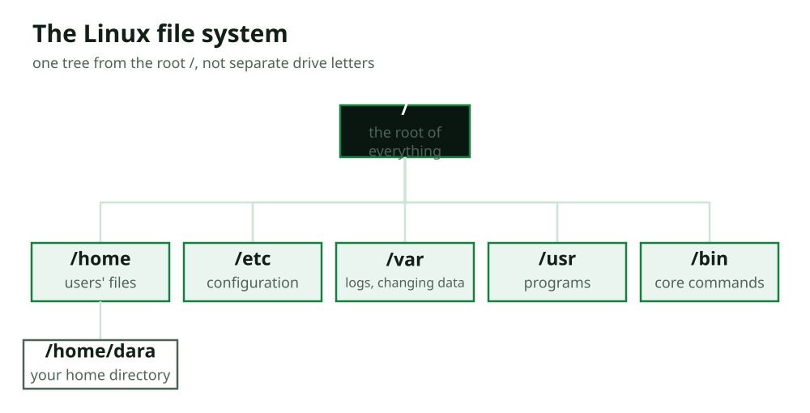

# Section 3: The Shell and the File System

> Covers chapter 3 in the [outline](../../../planning/outline.md).

## What You Will Learn

- What a shell is.
- What the prompt means, and your first commands.
- The Linux file system tree.
- Moving around with `pwd`, `cd`, and `ls`.
- Absolute and relative paths.
- Your home directory, and hidden files.
- Getting help with `man` and `--help`.

## Before You Start

You need lesson 2: a working Ubuntu VM with the `dara` account, and the Terminal open. Everything here is typed into that terminal. This is where the hands-on course truly begins. Every command is shown exactly as it runs, with the prompt `dara@ubuntu:~$`. Type each one yourself, nothing here can harm your VM, and if you ever worry, you have your snapshots.

---

## 1. What a Shell Is

When you open the Terminal, you are talking to a **shell**: a program that reads the commands you type, runs them, and shows you the result. The shell is the layer between you and the operating system (course 02, lesson 5): you type a command, the shell asks the kernel to do it, and the output comes back to your screen. The default shell on most Linux systems, including Ubuntu, is called **Bash**.

Think of the shell as a conversation with the computer, one line at a time:

- You type a **command** and press Enter.
- The shell runs it (often by starting a program, course 02's processes).
- The result, the **output**, appears below.
- The shell shows a fresh **prompt**, ready for your next command.

This loop, type, run, read, repeat, is how all command-line work happens, from this first lesson to the most advanced attack in later courses. The shell feels bare at first, but it is the most direct, honest way to use a computer: you say exactly what you want, and you see exactly what happens. That is why security people live in it.

## 2. The Prompt, and Your First Commands

Before you type anything, the shell shows a **prompt**. On your Ubuntu VM it looks like this:

```console
dara@ubuntu:~$
```

Every part of it tells you something:

- **`dara`** is your username (course 02, lesson 5: who you are).
- **`ubuntu`** is the computer's name (the one you set during install).
- **`~`** is where you are right now in the file system, `~` is shorthand for your home directory (topic 6).
- **`$`** means you are a normal user. (A `#` here would mean you are root, the all-powerful account, lesson 5, a sign to be careful.)

So `dara@ubuntu:~$` reads as "the user dara, on the computer ubuntu, in the home directory, as a normal user." This small line answers the two questions every security person asks on a system: *who am I* and *where am I* (course 02's "explore a running system" project).

Try your first command, `whoami`, which prints your username:

```console
dara@ubuntu:~$ whoami
dara
```

The shell ran the command and printed the answer, `dara`, then showed a new prompt. That is the whole rhythm of the command line. Everything from here is more of the same: a command, its output, a new prompt.

## 3. The Linux File System Tree

Before moving around, you need the map. In course 02 (lesson 7) you learned that files live in directories forming a tree. Linux organizes everything into **one single tree**, starting from a top called the **root**, written as a single slash `/`. There are no separate drive letters like Windows' `C:`; every disk, every file, every device hangs somewhere off that one `/`.



A few important directories, which you will meet again and again:

| Directory | What it holds | Why security cares |
|---|---|---|
| **`/`** | The root of everything | The top of the whole tree |
| **`/home`** | Each user's personal files (`/home/dara`) | Where user data lives |
| **`/etc`** | System configuration files | How the system and services are set up |
| **`/var`** | Data that changes, especially **logs** (`/var/log`) | Where evidence of activity is kept (lesson 10) |
| **`/usr`** and **`/bin`** | Installed programs and core commands | What the system can run |

You do not need to memorize all of these now. Just hold the shape: **one tree, rooted at `/`, with `/home` for users, `/etc` for configuration, and `/var/log` for logs.** When you investigate a Linux system later (forensics, incident response), you will go straight to these places.

## 4. Moving Around: pwd, cd, and ls

Three commands let you move through that tree and see what is around you. They are the first commands you will use constantly.

**`pwd`** ("print working directory") tells you where you are:

```console
dara@ubuntu:~$ pwd
/home/dara
```

So `~` in the prompt was `/home/dara`, your home directory. **`ls`** ("list") shows what is in the current directory:

```console
dara@ubuntu:~$ ls
Desktop  Documents  Downloads  Pictures  Public  Videos
```

These are the standard folders in a fresh home directory. **`cd`** ("change directory") moves you somewhere else:

```console
dara@ubuntu:~$ cd Documents
dara@ubuntu:~/Documents$ pwd
/home/dara/Documents
```

Notice the prompt changed from `~` to `~/Documents`, the shell always shows where you are. To go back up one level to the parent directory, use `cd ..` (the `..` from course 02, lesson 7):

```console
dara@ubuntu:~/Documents$ cd ..
dara@ubuntu:~$
```

And `cd` on its own, with nothing after it, always takes you home. With just these three, `pwd` to see where you are, `ls` to see what is here, `cd` to move, you can navigate the entire system. This is the ground floor of every Linux session.

## 5. Absolute and Relative Paths

When you tell a command where something is, you give a **path** (course 02, lesson 7). There are two kinds, and the difference matters.

- An **absolute path** starts from the root `/` and names the full route, so it works from anywhere. Example: `/home/dara/Documents`.
- A **relative path** starts from where you are *now*. Example: if you are in `/home/dara`, then `Documents` (relative) means the same place as `/home/dara/Documents` (absolute).

Both of these do the same thing if you start in your home directory:

```console
dara@ubuntu:~$ cd /home/dara/Documents      # absolute: works from anywhere
dara@ubuntu:~/Documents$ cd                 # back home
dara@ubuntu:~$ cd Documents                 # relative: from here
dara@ubuntu:~/Documents$
```

Two shortcuts appear in relative paths, both from course 02: `.` means "here" (the current directory) and `..` means "up one level." So `cd ..` goes up, and `./something` means "something right here."

This matters for security because, as course 02's files lesson noted, the `..` trick lets a careless program be pushed *out* of where it should stay (**path traversal**). Understanding absolute versus relative paths, and what `..` does, is the foundation for both using Linux and understanding that whole family of attacks (Web Application Security, course 11).

## 6. Your Home Directory, and Hidden Files

Your **home directory** (`/home/dara`, shown as `~`) is your own space: where your files live and where you can freely create, edit, and delete, without affecting the rest of the system. As a normal user, you have full control here and limited power elsewhere, that is least privilege (Security Fundamentals, lesson 7) built into the system.

But `ls` did not show everything. Linux has **hidden files**: any file whose name starts with a dot (`.`) is hidden from a normal listing. These are usually configuration files, and they are hidden just to keep listings tidy, not for security. To see them, add the `-a` flag ("all") to `ls`:

```console
dara@ubuntu:~$ ls -a
.  ..  .bashrc  .cache  .config  .profile  Desktop  Documents  Downloads
```

Now you see more: `.` (this directory) and `..` (the parent), and several dot-files like `.bashrc` (settings for your shell) and `.config` (where programs store their settings). 

This is an important lesson for security: **"hidden" does not mean secret or safe.** Hidden files are trivially visible with `ls -a`. Attackers often hide malicious files and configuration by giving them dot-names, hoping a casual look misses them, so an investigator always lists hidden files. When you examine a system, `ls -a` is a reflex: never trust a plain `ls` to show you everything.

## 7. Getting Help: man and --help

You will never memorize every command and option, and you do not need to, because Linux documents itself. Two tools give you help on the spot.

**`man`** ("manual") opens the full manual page for a command. For example, `man ls` shows everything `ls` can do:

```console
dara@ubuntu:~$ man ls
LS(1)                    User Commands                   LS(1)

NAME
       ls - list directory contents

SYNOPSIS
       ls [OPTION]... [FILE]...

DESCRIPTION
       List information about the FILEs (the current
       directory by default)...
```

(Press `q` to quit the manual.) The manual tells you what a command does, and every flag it accepts. Learning to read `man` pages is one of the most valuable Linux skills; it makes you self-sufficient.

For a quicker reminder, most commands accept **`--help`**, which prints a short summary:

```console
dara@ubuntu:~$ ls --help
Usage: ls [OPTION]... [FILE]...
List information about the FILEs (the current directory by default).
...
  -a, --all      do not ignore entries starting with .
  -l             use a long listing format
...
```

There is the `-a` flag you just used, and `-l` for the long listing you saw in lesson 2. Between `man` (full detail) and `--help` (a quick reminder), you can always find out what a command does and how to use it, which is exactly how real Linux users and security professionals work: not by memorizing, but by knowing how to look it up.

You now have the foundation: you understand the shell and the prompt, the shape of the file system, how to move around and list files (including hidden ones), the difference between absolute and relative paths, and how to get help. In the next lesson, you start working *with* files: creating, viewing, editing, and finding them.

---

## Common Mistakes

**1. Not reading the prompt.** `dara@ubuntu:~$` tells you who you are, where you are, and whether you are root (`#`). Glancing at it prevents many errors.

**2. Confusing absolute and relative paths.** An absolute path starts with `/` and works anywhere; a relative path depends on where you are. Mixing them up sends commands to the wrong place.

**3. Trusting a plain `ls`.** It hides dot-files. Attackers use dot-names to hide. Use `ls -a` to see everything, as a reflex.

**4. Thinking "hidden" means secret.** Hidden files are visible instantly with `ls -a`. Hiding is not protecting (an echo of course 02's encoding-vs-encryption point).

**5. Trying to memorize every command.** You cannot, and you do not need to. Use `man` and `--help`; knowing how to look things up is the real skill.

## Summary

| Command / idea | Remember |
|---|---|
| Shell (Bash) | Reads commands, runs them, shows output; the type-run-read loop |
| The prompt `dara@ubuntu:~$` | user @ computer : location, and `$` (normal) vs `#` (root) |
| File system tree | One tree from root `/`; `/home`, `/etc`, `/var/log` matter most |
| `pwd` / `ls` / `cd` | Where am I / what's here / move; `cd ..` up, `cd` home |
| Absolute vs relative path | From `/` (anywhere) vs from here; `.` here, `..` up |
| Home and hidden files | `~` = `/home/dara`; `ls -a` shows dot-files ("hidden" ≠ secret) |
| `man` / `--help` | Full manual / quick summary; look things up, don't memorize |

## Check Your Understanding

1. What does a shell do, and what is the default shell on Ubuntu?
2. In the prompt `dara@ubuntu:~$`, what do `dara`, `ubuntu`, `~`, and `$` each mean?
3. What do `pwd`, `ls`, and `cd` each do?
4. What is the difference between an absolute and a relative path? Give an example of each for the Documents folder.
5. What does `ls -a` show that `ls` does not, and why does that matter in security?
6. Is a "hidden" (dot) file secret? Why or why not?
7. You meet a command you do not know. Name two ways to find out what it does.

**Answers**

1. A shell reads the commands you type, runs them (asking the kernel), and shows the output. Ubuntu's default shell is Bash.
2. `dara` = your username; `ubuntu` = the computer's name; `~` = your current location (home directory); `$` = you are a normal user (a `#` would mean root).
3. `pwd` prints where you are (the working directory); `ls` lists what is in the current directory; `cd` changes to another directory (`cd ..` goes up, `cd` alone goes home).
4. An absolute path starts from `/` and works from anywhere; a relative path starts from where you are now. For Documents: absolute `/home/dara/Documents`; relative (from home) `Documents`.
5. `ls -a` also shows hidden files (names starting with a dot). It matters because attackers hide malicious files with dot-names, so an investigator must list hidden files to see everything.
6. No. A dot-file is hidden only from a plain listing and is revealed instantly by `ls -a`. Hiding is not protecting.
7. `man <command>` (the full manual page) and `<command> --help` (a quick summary).

## Practice

In your Ubuntu VM's terminal:

1. Run `whoami`, `pwd`, and `ls`. Write down who you are, where you are, and what is in your home directory.
2. Use `cd` to go into `Documents`, run `pwd` to confirm, then `cd ..` to go back, and `cd` alone to make sure you are home. Watch how the prompt changes each time.
3. Run `ls` and then `ls -a`. How many more items does `-a` show, and what are two of them?
4. Run `man ls`, read the first screen, and find what the `-l` flag does. Press `q` to quit.

### A Worked Example

1. `whoami` → `dara`. `pwd` → `/home/dara`. `ls` → `Desktop  Documents  Downloads  Pictures  Public  Videos`.
2. `cd Documents` then `pwd` → `/home/dara/Documents` (prompt shows `~/Documents`); `cd ..` returns to `/home/dara` (prompt `~`); `cd` keeps you at home.
3. `ls` shows the six folders; `ls -a` adds several dot-items, for example `.` , `..`, `.bashrc`, and `.config`, the hidden files a plain `ls` leaves out.
4. In `man ls`, the `-l` entry reads "use a long listing format", the detailed listing (permissions, owner, size, date) you saw in lesson 2. Press `q` to return to the prompt.
