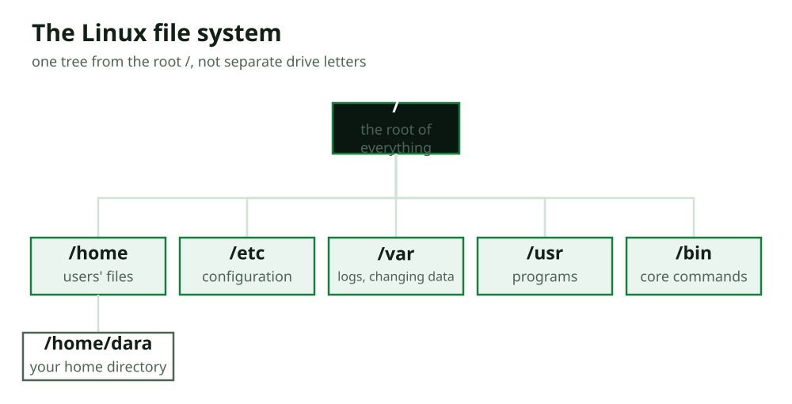

<!-- 1.1 -->
<!-- layout: title -->

# The Shell and the File System

## Video 1 · The Shell, the Prompt, and the File System

Linux for Security · Section 3

In this video, you will learn:

- What a shell is
- What the prompt tells you
- The Linux file system tree

---

<!-- 1.2 -->

# What a shell is

Open the Terminal and you're talking to a **shell**: a program that reads your commands, runs them, and shows the result. Ubuntu's default is **Bash**.

A conversation, one line at a time:

- Type a **command**, press Enter.
- The shell runs it (asks the kernel).
- The **output** appears.
- A fresh **prompt** waits for the next.

**Type → run → read → repeat.** The most direct, honest way to use a computer.

---

<!-- 1.3 -->

# The prompt tells you who and where

```console
dara@ubuntu:~$
```

- **`dara`** = your username (who you are).
- **`ubuntu`** = the computer's name.
- **`~`** = where you are (your home directory).
- **`$`** = a normal user. **`#`** would mean **root**, be careful!

```console
dara@ubuntu:~$ whoami
dara
```

The two questions every security person asks: **who am I, where am I.**

---

<!-- 1.4 -->
<!-- layout: visual -->

# One tree, rooted at /



Linux has **one tree** from the root `/`, no drive letters. `/home` = users, `/etc` = configuration, **`/var/log` = logs** (where evidence lives).

---

<!-- 1.5 -->
<!-- layout: recap -->

# Recap: shell, prompt, tree

- The **shell** (Bash) reads commands, runs them, shows output, type/run/read/repeat.
- The **prompt** `dara@ubuntu:~$` = user @ computer : where, and `$` (user) vs `#` (root).
- One **file system tree** from `/`; `/home`, `/etc`, and `/var/log` matter most.

**Next video:** moving around, paths, and getting help.

---

<!-- 2.1 -->
<!-- layout: title -->

# The Shell and the File System

## Video 2 · Moving Around, Paths, and Getting Help

Linux for Security · Section 3

In this video, you will learn:

- `pwd`, `ls`, and `cd`
- Absolute vs relative paths
- Hidden files, `man`, and `--help`

---

<!-- 2.2 -->

# Moving around: pwd, ls, cd

```console
dara@ubuntu:~$ pwd
/home/dara
dara@ubuntu:~$ ls
Desktop  Documents  Downloads  Pictures  Public  Videos
dara@ubuntu:~$ cd Documents
dara@ubuntu:~/Documents$
```

- **`pwd`**: where am I. **`ls`**: what's here. **`cd`**: move.
- `cd ..` goes **up** one level; `cd` alone goes **home**.

The prompt always shows where you are.

---

<!-- 2.3 -->

# Absolute vs relative paths

- **Absolute:** starts from `/`, works **anywhere**. `/home/dara/Documents`.
- **Relative:** starts from **here**. From home, `Documents` = the same place.
- `.` = here, `..` = up one level.

```console
dara@ubuntu:~$ cd /home/dara/Documents   # absolute
dara@ubuntu:~$ cd Documents              # relative
```

`..` is also the **path-traversal** trick (course 11): a path can climb *out* of where it should stay.

---

<!-- 2.4 -->

# Hidden files, and getting help

```console
dara@ubuntu:~$ ls -a
.  ..  .bashrc  .config  Desktop  Documents  Downloads
```

- **`ls -a`** shows **hidden** dot-files. **"Hidden" ≠ secret**, attackers hide with dot-names, so `ls -a` is a reflex.

**Don't memorize, look it up:**

- **`man ls`** = the full manual (press `q` to quit).
- **`ls --help`** = a quick summary of the flags.

---

<!-- 2.5 -->
<!-- layout: recap -->

# Recap: moving, paths, help

- **`pwd` / `ls` / `cd`** navigate; `cd ..` up, `cd` home.
- **Absolute** (from `/`, anywhere) vs **relative** (from here); `..` is the path-traversal trick.
- **`ls -a`** reveals hidden files, "hidden" isn't secret.
- **`man`** and **`--help`** mean you look things up, not memorize.

**Next lesson:** working with files, create, view, edit, and find them.
