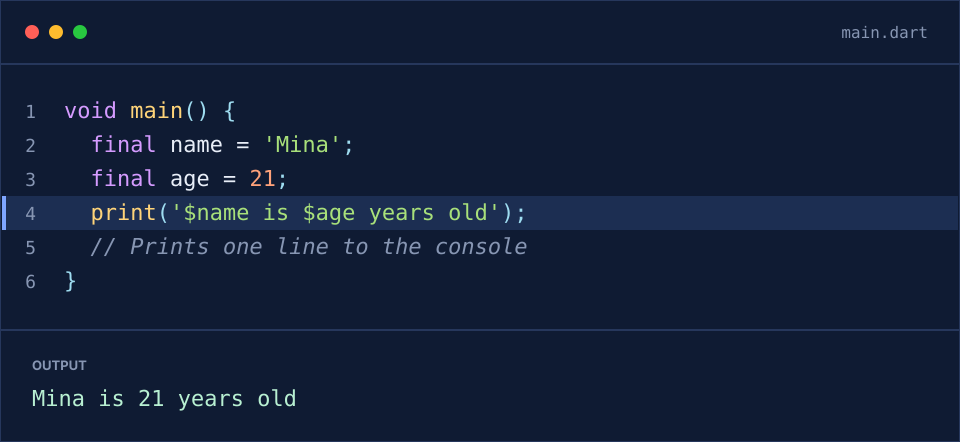
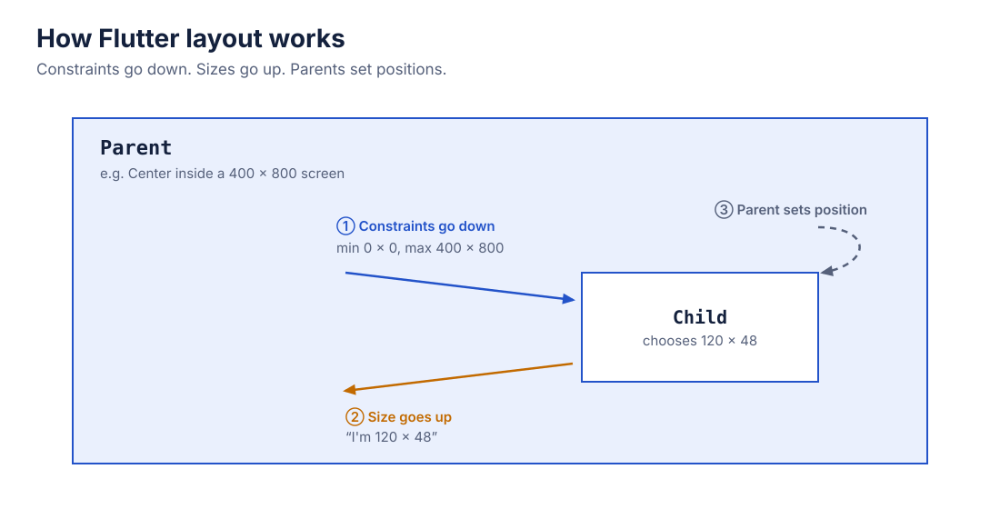
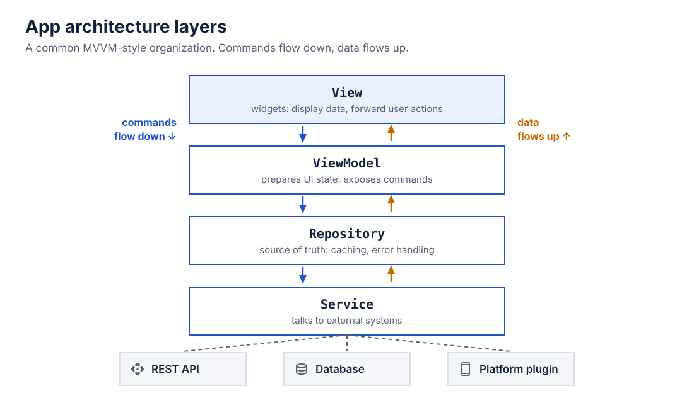

# Assets

Everything the slides and teaching documents share: logos, fonts, colors, icons, slide building blocks, and concept diagrams. Follow the [style guide](../STYLE-GUIDE.md) for how to use them.

| Folder | What's inside | Made by |
|---|---|---|
| [`logos/`](logos/) | Official logos for languages, platforms, and tools, with each brand's usage rules and credit lines | Their owners (unmodified) |
| [`mascots/kodee/`](mascots/kodee/) | Kodee, the Kotlin mascot (used instead of the restricted Kotlin logo) | JetBrains, CC BY 4.0 |
| [`fonts/`](fonts/) | Inter (text), Google Sans (Khmer text), JetBrains Mono (code), IBM Plex Sans and Mono (the Swift course), Source Sans 3 and Source Code Pro (the C/C++ course), and Bricolage Grotesque and Reddit Mono (the Rust course); the other courses' fonts are listed in `tools/course_themes.py` | Open source, SIL Open Font License |
| [`theme/`](theme/) | Color and font tokens: `tokens.json` (source) and `tokens.css` (generated) | Us |
| [`icons/material-symbols/`](icons/material-symbols/) | 116 icons chosen for the course topics | Google, Apache 2.0 |
| [`templates/`](templates/) | Code panel, device frames, callouts, and badges | Us, generated |
| [`diagrams/`](diagrams/) | Concept diagrams for the Dart and Flutter decks | Us, generated |
| [`screenshots/`](screenshots/) | Real screenshots of the tools (terminal, VS Code, Android Studio, DartPad), cropped, with private details removed | Us, captured |
| [`covers/`](covers/) | Cover backgrounds for the full books, such as the Swift book's dark background with an orange glow | Us, made by `tools/build_lessons.py` |

## Fonts

| Use | Font | Files |
|---|---|---|
| Headings and body text | **Inter** | `fonts/inter/` |
| Khmer headings and text | **Google Sans** | `fonts/google-sans/` |
| Code, file names, widget names | **JetBrains Mono** | `fonts/jetbrains-mono/` |
| Swift course: headings and text | **IBM Plex Sans** | `fonts/ibm-plex-sans/` |
| Swift course: code | **IBM Plex Mono** | `fonts/ibm-plex-mono/` |
| C/C++ course: headings and text | **Source Sans 3** | `fonts/source-sans-3/` |
| C/C++ course: code | **Source Code Pro** | `fonts/source-code-pro/` |
| Rust course: headings and text | **Bricolage Grotesque** | `fonts/bricolage-grotesque/` |
| Rust course: code | **Reddit Mono** | `fonts/reddit-mono/` |
| Java course: headings and text | **Rubik** | `fonts/rubik/` |
| Java course: code | **Cascadia Code** | `fonts/cascadia-code/` |
| Spring Boot course: headings and text | **Urbanist** | `fonts/urbanist/` |
| Spring Boot course: code | **Intel One Mono** | `fonts/intel-one-mono/` |

- **Keynote, PowerPoint, Google Slides, Figma:** install the files in `static/` (one file per weight). Variable fonts don't work reliably in PowerPoint.
- **HTML-based slides:** `theme/tokens.css` already loads the files in `web/`.
- Both fonts may be used, embedded, and shared freely. Keep each folder's license file with the fonts.

## Colors

All colors live in [`theme/tokens.json`](theme/tokens.json). Every text color meets the WCAG AA contrast minimum (4.5:1) against the background it's meant for, including code on a highlighted line.

| Group | Use it for |
|---|---|
| `light` | Normal slides: white background, navy text (`#14213D`), blue accent (`#2353C9`) |
| `dark` | Section openers and title slides: navy background (`#0F1B33`) |
| `code` | The code panel: syntax colors, highlighted line, output |
| `callout` | Note (blue), Tip (green), Warning (amber), Practice (purple) |
| `diagram` | Boxes, arrows, and the orange highlight used in diagrams |
| `topic-accent` | Each language's brand color, for small touches on its own deck only |

## Icons

The icons come from [Material Symbols](https://fonts.google.com/icons) (Rounded style), the same icon family Flutter uses. That way an icon on a slide matches what learners see in `Icons.*` code. File names match the official icon names (`lightbulb.svg`, `cloud_sync.svg`, …). To add an icon, download it from the [official repository](https://github.com/google/material-design-icons/tree/master/symbols/web) using the `materialsymbolsrounded` 24 px version. No attribution is needed on slides; keep the `LICENSE` file in the folder.

## Templates

| File | What it is |
|---|---|
| [`code-panel.svg`](templates/code-panel.svg) | The dark code panel from the style guide: window dots, file name, line numbers, highlighted line, output area. Use it as a visual reference when building code slides, or as an image. |
| [`browser-frame.svg`](templates/browser-frame.svg) | Browser window for Flutter web. Place a 1280 × 720 screenshot at (0, 56). |
| [`desktop-frame.svg`](templates/desktop-frame.svg) | Desktop app window. Place a 1280 × 760 screenshot at (0, 40). |
| `phone-placeholder.svg` | A plain dashed 390 × 844 box marking where a phone screenshot goes. No device frame: the screenshot replaces it as-is. |
| `browser-placeholder.svg`, `desktop-placeholder.svg` | The browser and desktop frames with a dashed "SCREENSHOT" area. |
| `callout-*.svg` | Note, Tip, Warning, and Practice boxes with placeholder text |
| `badge-*.svg` | Compact versions (icon + label) for slide corners |

Phone screenshots go on slides without a device frame. Don't use Apple or Google device photos or frames. See [App Screenshots](../STYLE-GUIDE.md#app-screenshots) for the placeholder workflow.



## Diagram Folders

Diagrams that belong to one course are in a folder named like the course, for example `diagrams/01-dart/` or `diagrams/14-mobile-security/`. Each course's diagrams are made by its own script, `build_<course>_diagrams.py`, with the shared drawing helpers in `diagram_kit.py` (the Dart ones by `build.py`). Diagrams that several courses use stay at the top of `diagrams/`.

## Course Marks and Fonts

Web Development (09) and courses 11–20 have no brand logo, so each has a course mark in `icons/courses/`, made by `build_course_icons.py` from a Material Symbols icon (Apache License 2.0). Each course also has its own pair of fonts in `fonts/`, all under the SIL Open Font License or the Ubuntu Font Licence; `tools/course_themes.py` lists which course uses which.

## Diagrams

| Diagram | For |
|---|---|
| [`dart-sync-vs-async.svg`](diagrams/01-dart/sync-vs-async.svg) | Dart section 9: Async Programming |
| [`dart-isolates.svg`](diagrams/01-dart/isolates.svg) | Dart section 8: Advanced Dart |
| [`dart-debugging-steps.svg`](diagrams/01-dart/debugging-steps.svg) | Dart section 11: Testing and Debugging |
| [`dart-test-double.svg`](diagrams/01-dart/test-double.svg) | Dart section 11: Testing and Debugging |
| [`dart-singleton.svg`](diagrams/01-dart/singleton.svg) | Dart section 12: Design Patterns |
| [`dart-factory.svg`](diagrams/01-dart/factory.svg) | Dart section 12: Design Patterns |
| [`dart-builder.svg`](diagrams/01-dart/builder.svg) | Dart section 12: Design Patterns |
| [`dart-repository.svg`](diagrams/01-dart/repository.svg) | Dart section 12: Design Patterns |
| [`dart-dependency-injection.svg`](diagrams/01-dart/dependency-injection.svg) | Dart section 12: Design Patterns |
| [`dart-adapter.svg`](diagrams/01-dart/adapter.svg) | Dart section 12: Design Patterns |
| [`dart-observer.svg`](diagrams/01-dart/observer.svg) | Dart section 12: Design Patterns |
| [`dart-strategy.svg`](diagrams/01-dart/strategy.svg) | Dart section 12: Design Patterns |
| [`dart-project-steps.svg`](diagrams/01-dart/project-steps.svg) | Dart section 13: Projects |
| [`dart-final-project.svg`](diagrams/01-dart/final-project.svg) | Dart section 13: Projects |
| [`dart-scope.svg`](diagrams/01-dart/scope.svg) | Dart section 4: Functions (scope) |
| [`dart-recursion-call-stack.svg`](diagrams/01-dart/recursion-call-stack.svg) | Dart section 4: Functions (recursion) |
| [`flutter-widget-tree.svg`](diagrams/02-flutter/widget-tree.svg) | Flutter section 2: Widgets and Composition |
| [`flutter-layout-constraints.svg`](diagrams/02-flutter/layout-constraints.svg) | Flutter section 3: Layout and Visual Style |
| [`flutter-stateful-lifecycle.svg`](diagrams/02-flutter/stateful-lifecycle.svg) | Flutter section 6: State and Widget Lifecycle |
| [`state-local-vs-shared.svg`](diagrams/state-local-vs-shared.svg) | Flutter sections 6 and 11: State |
| [`rest-request-flow.svg`](diagrams/rest-request-flow.svg) | Flutter section 8: Networking and Local Data |
| [`app-architecture-layers.svg`](diagrams/app-architecture-layers.svg) | Flutter section 11: Architecture and Advanced State |
| [`git-branch-and-merge.svg`](diagrams/git-branch-and-merge.svg) | Flutter section 14: Workflow and Release |
| [`ci-cd-pipeline.svg`](diagrams/ci-cd-pipeline.svg) | Flutter section 14 and topic 09: CI/CD |

 

## Changing Templates and Diagrams

Templates and diagrams are generated by [`build.py`](build.py) from the colors in `theme/tokens.json`. To change one, edit `build.py` (not the SVG) and rebuild. After changing a color, also regenerate the CSS:

```sh
python3 assets/build.py
python3 assets/theme/build-css.py
```

This keeps every diagram consistent. SVGs that are edited by hand will be overwritten on the next build. If a slide needs a one-off variation, copy the SVG into that topic's folder first.

## Still Missing

- **App screenshots:** captured by hand from our own example code. Slides use the placeholder frames until then; search for `SCREENSHOT TODO` to find them.
- **Logos for topics 11–20:** these topics use course marks; add a tool logo only when a lesson needs one, following the rules in [`logos/README.md`](logos/README.md).
