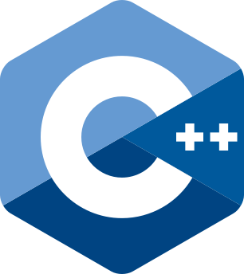

# Logos

Official logos for the slide decks. Every file is the official artwork, downloaded unchanged from its owner's brand page. Only the file names were changed so every brand follows the same pattern.

## File Naming

| File                        | Use it for                                                  |
| --------------------------- | ----------------------------------------------------------- |
| `<brand>-icon.svg`          | The mark alone: cover slides, section openers, small badges |
| `<brand>-logo-light-bg.svg` | Mark + name, on white or light backgrounds                  |
| `<brand>-logo-dark-bg.svg`  | Mark + name, on dark backgrounds                            |

## Logos by Topic

| Topic                   | Logo files                                                                                                                                                                                                                                                                                                                                                                                                                                                                                                                                                    | Preview                                                                                                                                                     |
| ----------------------- | ------------------------------------------------------------------------------------------------------------------------------------------------------------------------------------------------------------------------------------------------------------------------------------------------------------------------------------------------------------------------------------------------------------------------------------------------------------------------------------------------------------------------------------------------------------- | ----------------------------------------------------------------------------------------------------------------------------------------------------------- |
| 01. Dart                | [`dart/`](dart/)                                                                                                                                                                                                                                                                                                                                                                                                                                                                                                                                              |                                                                                          |
| 02. Flutter             | [`flutter/`](flutter/)                                                                                                                                                                                                                                                                                                                                                                                                                                                                                                                                        |                                                                                 |
| 03. Swift               | [`swift/`](swift/)                                                                                                                                                                                                                                                                                                                                                                                                                                                                                                                                            |                                                                                       |
| 04. iOS Development     | Use the Swift logo (see note below)                                                                                                                                                                                                                                                                                                                                                                                                                                                                                                                           |                                                                                                |
| 05. Kotlin              | [`../mascots/kodee/`](../mascots/kodee/) for covers and section openers; [`kotlin/kotlin-icon.svg`](kotlin/) only next to other language icons (see rules below)                                                                                                                                                                                                                                                                                                                                                                                              |   |
| 06. Android Development | [`android/`](android/)                                                                                                                                                                                                                                                                                                                                                                                                                                                                                                                                        |                                                                                   |
| 07. JavaScript          | [`javascript/`](javascript/)                                                                                                                                                                                                                                                                                                                                                                                                                                                                                                                                  |                                                                                         |
| 08. TypeScript          | [`typescript/`](typescript/)                                                                                                                                                                                                                                                                                                                                                                                                                                                                                                                                  |                                                                                 |
| 09. Web Development     | [`web/`](web/): the cover honeycomb is [`honeycomb/web.svg`](honeycomb/) (HTML5 in the middle, with JavaScript, TypeScript, React, Firebase, Git, and CSS around it) and a row for slides on light and dark backgrounds. Made from [`html5/`](html5/), [`css/`](css/), [`javascript/`](javascript/), [`typescript/`](typescript/), [`react-native/`](react-native/), [`git/`](git/), and [`firebase/`](firebase/). No Node.js logo: the OpenJS Foundation follows the Linux Foundation rules, which forbid a logo on a book cover without written permission. |                                                         |
| 10. React Native        | [`react-native/`](react-native/)                                                                                                                                                                                                                                                                                                                                                                                                                                                                                                                              |                                                                           |
| 11–20                   | None of their own. Each has a course mark in [`../icons/courses/`](../icons/courses/). On the book cover the mark sits in a honeycomb ([`honeycomb/`](honeycomb/)) with the platforms the book covers: Android, Swift (for iOS, since the Apple logo may not be used), Flutter, React Native, Kotlin, and Dart, Git, Firebase, VS Code, or Android Studio where the book uses them. The sets are `LOGO_SETS` in `tools/course_themes.py`; `build_logo_sets.py` draws them.                                                                                    |                                                                                                                                                             |
| 21. C/C++               | [`c/`](c/) (community icon, not official) and [`cpp/`](cpp/) (official)                                                                                                                                                                                                                                                                                                                                                                                                                                                                                       |                                                     |
| 22. Rust                | [`rust/`](rust/): the mark, and the white-outline mark for dark backgrounds                                                                                                                                                                                                                                                                                                                                                                                                                                                                                   |                                                                                                   |
| 23. Java                | [`java/`](java/)                                                                                                                                                                                                                                                                                                                                                                                                                                                                                                                                              |                                                                                                   |
| 24. Spring Boot         | [`spring-boot/`](spring-boot/)                                                                                                                                                                                                                                                                                                                                                                                                                                                                                                                                |                                                                              |

## Tool and Service Logos

For slides that mention a specific tool. Use them small, next to the tool's name or a screenshot, never as the main element of a slide.

| Tool               | Files                                                               | Preview                                                                                  |
| ------------------ | ------------------------------------------------------------------- | ---------------------------------------------------------------------------------------- |
| Firebase           | [`firebase/`](firebase/): icon, logo for light and dark backgrounds |           |
| Git                | [`git/`](git/): icon, logo for light and dark backgrounds           |                          |
| Visual Studio Code | [`vscode/`](vscode/): icon only (see rules)                         |                         |
| Android Studio     | [`android-studio/`](android-studio/): icon only                     |  |

## Sources and Usage Rules

Each brand allows use in training or course material within its rules. Kotlin is the exception: its full logo is restricted, so its section explains what to use instead. In all cases: **do not stretch, recolor, rotate, or otherwise modify a logo**, keep clear space around it, and never make it look like the owner made or endorses the course.

### Dart and Flutter (Google)

- **Source:** [Dart brand guidelines](https://dart.dev/brand) ([asset archive](https://services.google.com/fh/files/misc/dart_brand_guidelines_assets.zip)) · [Flutter brand](https://flutter.dev/brand) ([asset archive](https://flutter.dev/flutter-brand-assets.zip))
- **Permission:** both guidelines explicitly allow use "in training materials … that provide instructions or tips" on using the SDK.
- **Rules:** use the name as an adjective ("the Flutter SDK", not "a Flutter"). Use ™ on the first or most prominent mention.
- **Credit line** (once per deck, for example on the final slide):
  > Dart, Flutter, and the related logos are trademarks of Google LLC. We are not endorsed by or affiliated with Google LLC.

### Swift (Apple)

- **Source:** [Apple Developer, Swift resources](https://developer.apple.com/swift/resources/) ([logo archive](https://developer.apple.com/swift/downloads/swift-logo.zip)). The full guidelines are in [`swift/swift-logo-guidelines.pdf`](swift/swift-logo-guidelines.pdf).
- **Permission:** educators may use it "in course materials and technical publications related to teaching, training, or describing the Swift programming language."
- **Rules:** use the color logo in most layouts. Do not add ™ or ® to the logo artwork. Never imitate Apple's own communications.
- **Credit line** (required on every deck that uses it, listing only the Apple trademarks actually mentioned):

  > Swift and the Swift logo are trademarks of Apple Inc.

  The iOS deck mentions more Apple trademarks, so use for example:

  > Apple, iPhone, iPad, Xcode, Swift, and the Swift logo are trademarks of Apple Inc., registered in the U.S. and other countries.

### C++ (Standard C++ Foundation)

- **Source:** [isocpp/logos](https://github.com/isocpp/logos) on GitHub (`cpp_logo.svg`, designed by Jeremy Kratz). Terms: [isocpp.org terms of use](https://isocpp.org/home/terms-of-use), checked 2026-11-03.
- **Permission:** the unaltered logo may be used with material, including educational material, "that is related to the standardized C++ language". The use must not imply endorsement of a product or organization.
- **Rules:** do not change the logo. Put it beside or near other art, with no overlap. Do not make it part of another logo. If a use is not clearly covered, ask the Foundation first.
- **Credit line:**
  > The C++ logo is a trademark of the Standard C++ Foundation. We are not endorsed by or affiliated with the Standard C++ Foundation.

### C

- C has **no official logo**. `c/c-icon.svg` is the familiar community hexagon icon, downloaded unchanged from [programming-languages-logos](https://github.com/abrahamcalf/programming-languages-logos) by Carlos Abraham (MIT License, in `c/LICENSE.txt`). That project does not say who first drew the icon. Do not present it as an official C logo.
- **Do not make a C icon by removing the `++` from the C++ logo.** The Foundation does not normally approve modified versions of its logo.
- **Credit line:**
  > C icon from programming-languages-logos by Carlos Abraham, MIT License.
- The blue "C" on Wikimedia Commons (`The_C_Programming_Language_logo.svg`) is not from a standards body, and its page gives conflicting license information (a public-domain notice and CC BY-SA 4.0). Do not use it.
- Keep the mark beside the C++ logo, with no overlap. Do not combine them into one logo.

### Kotlin (Kotlin Foundation / JetBrains)

Kotlin's rules are stricter than the others, so it has three different assets with different permissions.

- **Source:** [Kotlin brand assets](https://kotlinlang.org/docs/kotlin-brand-assets.html) ([logo archive](https://resources.jetbrains.com/storage/products/kotlin/docs/kotlin_logos.zip), [mascot archive](https://resources.jetbrains.com/storage/products/kotlin/docs/kotlin_mascot_2.zip)) · [Kotlin brand usage guidelines](https://kotlinfoundation.org/guidelines/)
- **Kotlin name:** may be used to refer to the language, including to "promote or teach the Kotlin programming language". It must not appear in the course's own brand name.
- **Full Kotlin logo (mark + name): not included.** It "may only be used for official or pre-approved purposes."
- **Kotlin icon (`kotlin-icon.svg`):** allowed only "among other programming languages icons", for example on a course roadmap slide next to Dart, Swift, and JavaScript. Do not use it alone on a cover or for promoting an event.
- **Kodee mascot (`../mascots/kodee/`):** the foundation's suggested alternative for anything else, and free to use under [CC BY 4.0](https://creativecommons.org/licenses/by/4.0/). Use Kodee on the Kotlin cover and section openers. The full set of poses, emoji, and GIFs is in the mascot archive.
- **Credit line** (required when Kodee appears):
  > Kodee by JetBrains s.r.o. is licensed under CC BY 4.0.

### Android (Google)

- **Source:** [Android brand guidelines](https://developer.android.com/distribute/marketing-tools/brand-guidelines)
- **Permission:** the Android robot is shared under Creative Commons Attribution 3.0 and may be reproduced or modified.
- **Rules:** the **Android wordmark and its custom typeface may not be used** without written permission from Google, so only the robot head is included. Write "Android" with a capital A, never plural or possessive. Use ™ on the first mention.
- **Credit line** (required by the license):
  > The Android robot is reproduced or modified from work created and shared by Google and used according to terms described in the Creative Commons 3.0 Attribution License. Android is a trademark of Google LLC.

### JavaScript (community)

- **Source:** [voodootikigod/logo.js](https://github.com/voodootikigod/logo.js). JavaScript has no official logo. This community logo was released by JSConf under the MIT license.
- **Rules:** none beyond the MIT license. A credit line is optional.

### HTML5 (W3C)

- **Source:** [w3.org/html/logo](https://www.w3.org/html/logo/), file `HTML5_Logo.svg`.
- **License:** Creative Commons Attribution 3.0 ([FAQ](https://www.w3.org/html/logo/faq.html)). Credit: "HTML5 Logo by W3C". The book's credits line gives it.
- **Changes:** none in `html5/`. In `web/web-logos-dark-bg.svg` the "HTML" wordmark is white so it shows on dark slides.

### CSS (CSS-Next Community Group)

- **Source:** [github.com/CSS-Next/logo.css](https://github.com/CSS-Next/logo.css), file `css.svg`.
- **License:** CC0 1.0 (public domain). Credit is not required; we give it anyway. Follow their usage guidelines: do not change the logo.

### TypeScript (Microsoft)

- **Source:** [TypeScript branding](https://www.typescriptlang.org/branding/) ([asset pack](https://www.typescriptlang.org/branding/typescript-design-assets.zip)), checked 2026-11-05. `typescript-icon.svg` is `ts-logo-512.svg`; `typescript-logo-light-bg.svg` and `typescript-logo-dark-bg.svg` are `ts-lettermark-blue.svg` and `ts-lettermark-white.svg`, unchanged.
- **Permission:** the page asks that the blue TypeScript mark be used as the primary logo, for example in articles and other material about TypeScript.
- **Rules:** do not use the logo for your own application or product, do not change its shape, do not put it inside your own logo, and do not name a product in a way that suggests TypeScript endorses it. The "TS" is white, not transparent.
- **Credit line:**

  > TypeScript and the TypeScript logo are trademarks of Microsoft Corporation. We are not endorsed by or affiliated with Microsoft.

### Rust (Rust Foundation)

- **Source:** [rust-lang/rust-artwork](https://github.com/rust-lang/rust-artwork/tree/master/logo), checked 2026-11-05. `rust-icon.svg` is `rust-logo.svg`, and `rust-icon-dark-bg.svg` is `rust-logo-white-outline.svg` (made for dark backgrounds), both unchanged.
- **License:** the artwork is under [CC BY 4.0](https://creativecommons.org/licenses/by/4.0/): give credit, link the license, and say if it was changed. We do not change it.
- **Trademark:** the Rust and Cargo names and logos are trademarks of the Rust Foundation ([policy](https://rustfoundation.org/policy/rust-trademark-policy/)). Most non-commercial uses need no permission; nothing may look official or suggest that the Rust project endorses us. If the course is ever sold, read the policy again and ask `trademark@rust-lang.org` if needed.
- **Rules:** use it for the course about Rust, never as our own logo or inside our own logo. Ferris, the crab, is an unofficial mascot and is not used.
- **Credit line:**

  > Rust and Cargo, and the Rust logo, are trademarks of the Rust Foundation. The Rust logo is from rust-lang/rust-artwork, CC BY 4.0. We are not endorsed by or affiliated with the Rust Foundation or the Rust project.

### Java (Oracle)

- **Source:** Oracle Java brand guidance and OpenJDK community project artwork.
- **Rules:** use the logo only to refer to the Java programming language and platform in an educational context. Do not alter the proportions or colors.
- **Credit line:**
  > Java, JVM, and the Java logo are trademarks or registered trademarks of Oracle and/or its affiliates. We are not endorsed by or affiliated with Oracle.

### Spring Boot (Broadcom)

- **Source:** Spring brand assets from spring.io.
- **Rules:** use the logo only to identify Spring and Spring Boot frameworks in educational materials.
- **Credit line:**
  > Spring and Spring Boot are trademarks of Broadcom Inc. and/or its subsidiaries in the United States and other countries. We are not endorsed by or affiliated with Broadcom.

### React Native (Meta)

- **Source:** the logo used on [reactnative.dev](https://reactnative.dev), taken from the [react-native-website repository](https://github.com/facebook/react-native-website/blob/main/website/static/img/header_logo.svg).
- **Rules:** Meta publishes no separate brand kit. Use the logo only to identify the technology being taught, unmodified.
- **Credit line:**
  > React Native and the React logo are trademarks of Meta Platforms, Inc. We are not endorsed by or affiliated with Meta.

### Firebase (Google)

- **Source:** [Firebase brand guidelines](https://firebase.google.com/brand-guidelines) ([asset archive](https://firebase.google.com/static/downloads/brand-guidelines/firebase-brand-assets.zip))
- **Permission:** "The standard lockup logo can be used in presentation slides and blog posts." The icon alone may be used "when there is limited vertical and horizontal space."
- **Rules:** never make Firebase branding the most prominent element on a slide. Minimum height 24 px. Do not alter or recolor.
- **Credit line:** none required. For consistency, add Firebase to the Google line: "Dart, Flutter, Firebase, and the related logos are trademarks of Google LLC."

### Git (Software Freedom Conservancy)

- **Source:** [Git logos](https://git-scm.com/community/logos) · [Git trademark policy](https://git-scm.com/about/trademark)
- **Permission:** use without written permission is allowed "to factually refer to the Git Project itself, its products, or its protocols."
- **Rules:** use ™ on the first prominent mention. Do not imply a closer association with the Git Project than exists.
- **Credit line** (required by the logo's CC BY 3.0 license):
  > Git Logo by Jason Long is licensed under the Creative Commons Attribution 3.0 Unported License.

### Visual Studio Code (Microsoft)

- **Source:** [Visual Studio Code brand guidelines](https://code.visualstudio.com/brand) ([icon archive](https://code.visualstudio.com/assets/branding/visual-studio-code-icons.zip))
- **Permission:** the icon may be used "in a documentation or tutorial (in both text and video formats)."
- **Rules:** do not combine the icon with the "Visual Studio Code" name as a logo lockup; write the name separately in normal text. A white version exists in the archive but is allowed only when the blue icon lacks contrast, such as on a blue background.
- **Credit line:**
  > Visual Studio Code, VS Code, and the Visual Studio Code icon are trademarks of Microsoft Corporation. All rights reserved.

### Android Studio (Google)

- **Source:** the icon on the [Android Studio download page](https://developer.android.com/studio).
- **Permission (please review):** Android Studio has no brand page of its own. It is included under Google's general [brand guidance](https://about.google/brand-resource-center/guidance/), which allows "specific product icons for educational purposes in textbooks or other standard teaching materials." Remove it if you read that more narrowly.
- **Credit line:** none published. Add it to the Google line, for example "Android Studio is a trademark of Google LLC."

## Not Included

- **Apple logo, Xcode icon, and SwiftUI icon:** Apple's [guidelines for third parties](https://www.apple.com/legal/intellectual-property/guidelinesfor3rdparties.html) say "You may not use the Apple Logo or any other Apple-owned graphic symbol, logo, or icon" without an express written license, and there is no education exception. Write the names as text with the Apple credit line, and use the Swift logo for the iOS deck.
- **App Store badge:** licensed only for linking to your own app on the App Store.
- **Google Play badge and icon:** reserved for promoting content on Google Play. Write "Google Play" as text.
- **GitHub logo:** GitHub allows it only for linking to GitHub, showing a GitHub integration, or articles about GitHub; other uses need written permission. Write "GitHub" as text.
- **Full Kotlin logo (mark + name):** restricted to official or pre-approved use. The Kotlin deck uses Kodee instead.
- **Jetpack Compose logo and Android wordmark:** Google does not publish these for third-party use. The Android deck uses the Android robot instead.
- **Material Design and pub.dev logos:** neither has a brand page or published usage terms. Write the names as text.
- **Flutter DevTools:** has no separate logo. Use the Flutter logo or a DevTools screenshot.
